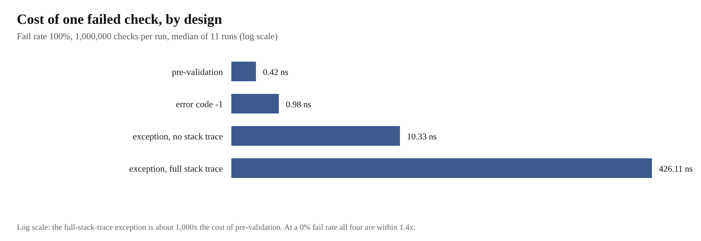
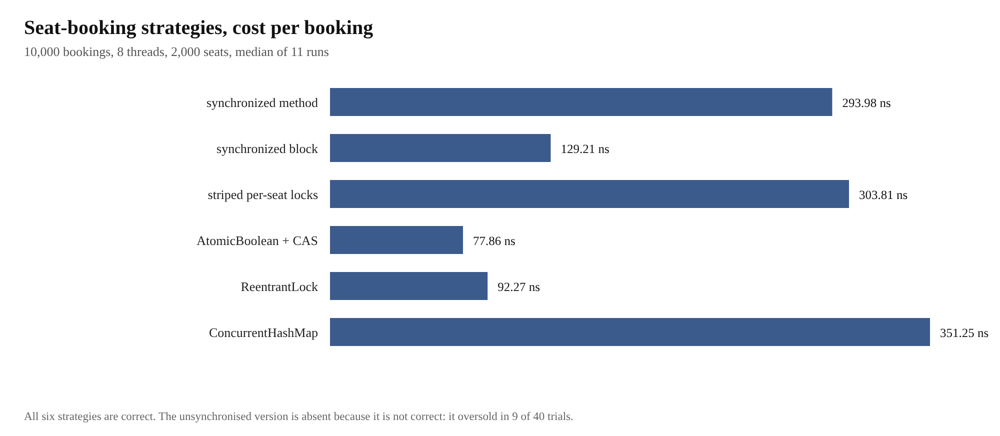
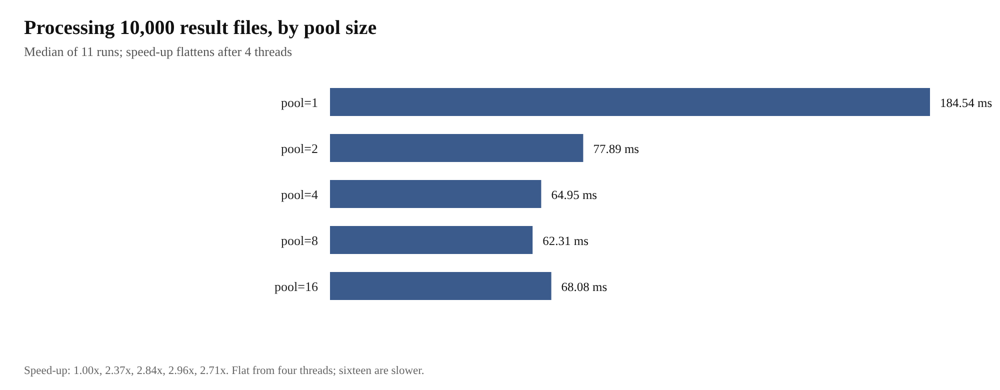

# Programming in Java (CSA09) - Assignment 3 (CO3)

**Exception Handling, Multithreading and Concurrency**

| | |
|---|---|
| Name | Vignesh S |
| Register Number | 192325002 |
| Course | CSA09 - Programming in Java |
| Assignment | 3 (CO3) |
| Total Marks | 50 |
| JDK | OpenJDK 21.0.12.1 |
| Platform | Linux x86-64 |
| Repository | `CSA09-Java/Assignment-3` |

> **Pair-work note.** This assignment is set as pair work with alternating
> individual responsibilities. The questions below are answered in full, with
> the Student A and Student B parts labelled as the handout requires. The
> handout also states that *both* students must execute every question in
> their own repository; this repository is Vignesh S's own execution of the
> complete assignment. The partner column of the Individual Contribution
> Record is left blank for the partner's name and register number to be
> entered before submission.

---

## How to run everything

```bash
# the shared measurement harness
javac -d lib/out lib/bench/Bench.java

# Q1  exception handling in an ATM
javac -d Q1 Q1/AtmSimulation.java && java -cp Q1 AtmSimulation
javac -cp lib/out -d Q1 Q1/ExceptionCost.java && java -cp Q1:lib/out ExceptionCost

# Q2  user-defined exceptions and propagation
javac -d Q2 Q2/StorageDemo.java && java -cp Q2 StorageDemo

# Q3  resource safety
javac -d Q3 Q3/SalesReport.java Q3/ResourceSafetyDemo.java && (cd Q3 && java -cp . ResourceSafetyDemo)

# Q4  threads and the life cycle
javac -d Q4 Q4/*.java && (cd Q4 && java -cp . ScannerStations && java -cp . StationExperiments \
    && java -cp . DaemonDemo user && java -cp . DaemonDemo daemon && java -cp . ThreadsVsPool)

# Q5  race conditions
javac -cp lib/out -d Q5 Q5/*.java && (cd Q5 && java -cp .:../lib/out SeatBooking && java -cp .:../lib/out RaceAnalysis)

# Q6  inter-thread communication
javac -d Q6 Q6/TokenCounter.java && (cd Q6 && java -cp . TokenCounter)

# Q7  concurrent fault-tolerant processor
javac -cp lib/out -d Q7 Q7/*.java && (cd Q7 && java -cp .:../lib/out ProcessorRunner)
```

Every program writes its console output to a `.txt` file beside its source,
and every timed program writes raw per-run timings to `data/`.

## Measurement discipline

Carried over from Assignment 2, because a single execution time is not a
measurement. `lib/bench/Bench.java` discards **5 warm-up runs**, performs
**11 measured runs**, and reports the **median** rather than the mean so that
one outlier cannot move the figure. It also reports **relative standard
deviation (RSD)**, which is what let three bad numbers in this assignment be
caught rather than published - see Q1 section 4 and Q7 section 3.3.

---

# Q1 - Handling Failure in a Bank ATM Simulation (6 marks, K4)

**Files:** `Q1/AtmSimulation.java`, `Q1/ExceptionCost.java`,
`Q1/compile_errors/`, `Q1/atm_output.txt`, `Q1/exception_cost.txt`

## Shared group work - the withdrawal

`AtmSimulation.withdraw()` is one `try` block with five `catch` clauses and a
`finally`. Money is held in **paise as a `long`**, never in `double`.

## Student A - exception design

### 1. The part of the `Throwable` hierarchy that matters here

```
Throwable
  +-- Error                                 NOT caught: the JVM is broken
  |     +-- StackOverflowError
  |     +-- OutOfMemoryError
  +-- Exception                             CHECKED unless under RuntimeException
        +-- IOException                     checked
        |     +-- NoSuchFileException       checked   <- card reader missing
        |     +-- AccessDeniedException     checked   <- card reader locked
        +-- InsufficientFundsException      checked   <- our own
        +-- UnknownAccountException         checked   <- our own
        +-- RuntimeException                UNCHECKED
              +-- IllegalArgumentException
              |     +-- NumberFormatException         <- letters typed
              +-- NullPointerException
              +-- ArithmeticException
```

The dividing line is `RuntimeException`, **not severity**. Anything under
`RuntimeException` or `Error` is unchecked; everything else under `Exception`
is checked and must be declared or handled.

### 2. Every point at which the withdrawal can fail

| # | Failure point | Exception type | Kind | Caught where |
|---|---|---|---|---|
| 1 | card-reader file missing | `NoSuchFileException` | checked | catch 3 (multi-catch) |
| 2 | card-reader permissions denied | `AccessDeniedException` | checked | catch 3 (multi-catch) |
| 2b | card-reader file unreadable | `IOException` | checked | catch 4 |
| 3 | letters typed for the amount | `NumberFormatException` | unchecked | catch 5 |
| 4 | amount negative or zero | `IllegalArgumentException` | unchecked | catch 5 |
| 5 | amount not a multiple of 100 | `IllegalArgumentException` | unchecked | catch 5 |
| 6 | account not held by the bank | `UnknownAccountException` | checked | catch 2 |
| 7 | balance lower than the amount | `InsufficientFundsException` | checked | catch 1 |
| 8 | JVM out of memory | `OutOfMemoryError` | Error | **not caught, by design** |

### 3. Why the catch blocks are in this order

The order is **forced by the language**, not chosen for style. Java matches
`catch` clauses top-down and takes the first whose type is assignable from the
thrown object, so a supertype placed first would make every subtype below it
unreachable. `javac` refuses to compile it.

Three real compiler errors were captured as evidence in
`Q1/compile_errors/compiler_errors.txt`:

```
BadOrder.java:14: error: exception NoSuchFileException has already been caught
        } catch (NoSuchFileException e) {       // NARROWER - unreachable

BadMultiCatch.java:8: error: Alternatives in a multi-catch statement cannot be
                             related by subclassing
        } catch (NumberFormatException | IllegalArgumentException e) {
  Alternative NumberFormatException is a subclass of alternative IllegalArgumentException

BadUnhandledChecked.java:8: error: unreported exception IOException; must be
                             caught or declared to be thrown
        return Files.readString(p);   // throws IOException - checked
```

The second of those **was our own mistake**, not a constructed example. The
first draft of `withdraw()` wrote `catch (NumberFormatException |
IllegalArgumentException e)`, and `javac` rejected it because
`NumberFormatException` *is* an `IllegalArgumentException`. The fix was a
single `catch (IllegalArgumentException e)`, which already covers both; the
multi-catch in the final program instead pairs two genuine **siblings**,
`NoSuchFileException` and `AccessDeniedException`.

All three errors are caught at **compile** time. A language without checked
exceptions would accept all three files and fail only when the card reader
happened to be missing.

### 4. What `finally` guarantees

That the **card is returned** and the dispenser is closed on every path out of
`withdraw()`: normal return, any of the five catch clauses, and an exception
that no catch matches. This is a physical-safety property, not a tidiness one -
an ATM that keeps a customer's card because an unexpected exception skipped
the clean-up needs an engineer to attend the machine.

## Student B - testing and tracing

### 5. Seven test inputs, each aimed at a different path

| ID | Account | Amount | Intent | Catch reached | `finally` ran? | Card returned? |
|---|---|---|---|---|---|---|
| T1 | 1001 | 200 | valid withdrawal | none (success) | yes | yes |
| T2 | 1001 | abc | letters for the amount | `IllegalArgumentException` (actual type `NumberFormatException`) | yes | yes |
| T3 | 1001 | -100 | negative amount | `IllegalArgumentException` | yes | yes |
| T4 | 1001 | 250 | not a multiple of 100 | `IllegalArgumentException` | yes | yes |
| T5 | 9999 | 100 | account not held | `UnknownAccountException` | yes | yes |
| T6 | 1002 | 200 | amount over the balance | `InsufficientFundsException` (short by Rs 150) | yes | yes |
| T7 | 1003 | 100 | account holds zero | `InsufficientFundsException` (short by Rs 100) | yes | yes |
| T8 | 1001 | 100 | card-reader file deleted | `NoSuchFileException` (multi-catch) | yes | yes |

T2 is worth noting: the message says `catch IllegalArgumentException` but the
actual runtime type printed is `NumberFormatException`. That is subtype
matching working - one clause, two faults.

### 6. `finally` runs even for an exception nothing catches

```
    about to throw an ArithmeticException that no catch handles
    [finally] card returned even though the exception escapes
    caught by main(): java.lang.ArithmeticException: / by zero
```

The `finally` line appears **before** the exception reaches `main()`. The card
is released on the way out.

### 7. A stack trace, line by line

```
java.lang.IllegalStateException: card reader returned an empty card number
    at AtmSimulation.deep3(AtmSimulation.java:...)
    at AtmSimulation.deep2(AtmSimulation.java:...)
    at AtmSimulation.deep1(AtmSimulation.java:...)
    at AtmSimulation.main(AtmSimulation.java:...)
```

| Line | What it names | How to read it |
|---|---|---|
| first | the type and the message | *what* went wrong |
| `at deep3` | where it was **thrown** | innermost frame |
| `at deep2` | its caller | one frame out |
| `at deep1` | its caller's caller | |
| `at main` | where the call chain began | outermost frame |

The trace reads **innermost first**. Each line below the top is the frame that
called the one above it. The first line belonging to our own code rather than
to the JDK is normally where to start looking.

## Joint design question - one `catch (Exception e)` for everything?

| What is lost | Consequence |
|---|---|
| the customer's message | every fault becomes one vague error |
| the ability to act differently | retry, refuse and call-an-engineer merge |
| the compiler's help | a new checked exception is silently absorbed |
| programming errors | a `NullPointerException` is reported as a bank rule |

Demonstrated - three different faults through one `catch (Exception e)`:

```
    abc       -> "Transaction failed. Please try again."   (actually NumberFormatException)
    100       -> "Transaction failed. Please try again."   (actually UnknownAccountException)
    200       -> "Transaction failed. Please try again."   (actually InsufficientFundsException)
```

**When it is acceptable:** at the outermost boundary of a long-running
process, as a last resort so one bad transaction does not kill the ATM - but
it must log the full exception before showing a generic message. Also in a
test harness whose job is to report that something failed.

**When it is not:** as the only handler inside `withdraw()`, which is exactly
where the faults still mean different things. Note it does **not** catch
`Error`, so `OutOfMemoryError` still terminates the JVM - which is correct: an
ATM with a broken heap must stop, not keep dispensing cash.

## Alternative concept and complexity analysis

Measured in `Q1/ExceptionCost.java`: 1,000,000 withdrawal checks per run, four
designs, at five different failure rates.

### Time

| Fail rate | Pre-validation | Error code -1 | Exception, no stack trace | Exception, full stack trace |
|---|---|---|---|---|
| 0% | 0.44 ns | 0.45 ns | 0.61 ns | 0.61 ns |
| 1% | 0.64 ns | 0.67 ns | 0.78 ns | 5.00 ns |
| 10% | 1.23 ns | 1.43 ns | 2.41 ns | 43.54 ns |
| 50% | 4.17 ns | 4.73 ns | 8.11 ns | 218.03 ns |
| 100% | 0.42 ns | 0.98 ns | 10.33 ns | **426.11 ns** |



**At a 0% fail rate the four designs are within 1.4x of each other**, and the
whole spread is 0.17 nanoseconds per check - the cost of an exception that is
never thrown is not measurable at this resolution. Entering a `try` block is
free: the JVM records the handler in an exception table attached to the
method, so no instructions are spent entering it.

**At a 100% fail rate the full-stack-trace exception is about 1,000x slower**
than pre-validation (426.11 ns against 0.42 ns).

### Where the cost actually is

The two exception rows differ by **one constructor argument**:

```java
super(message);                      // captures the stack
super(message, null, false, false);  // writableStackTrace = false
```

At 100%: 426.11 ns with the trace, 10.33 ns without. **About 98% of the cost
of throwing is capturing the stack trace**, not the `throw` or the unwinding.

### Space

| | Bytes each |
|---|---|
| exception **with** a stack trace | 781 |
| exception **without** a stack trace | 46 |
| boxed error code (`Long`) | 25 |
| primitive `long` error code | 0 - it lives in a register |

### Two things in the data that are not what they first look like

1. **The two cheap designs are slower at 50% than at 100%.** That is **branch
   prediction**, not a design effect. At 0% and 100% the comparison goes the
   same way every time and the processor predicts it perfectly; at 50% it is a
   coin toss and every misprediction discards a pipeline. The effect appears
   equally in the pre-validation and error-code rows, which is how we know it
   belongs to the branch and not to either design.

2. **Our first run of this program was wrong, and the RSD said so.** It
   reported the error-code design at 2.234 ms for the 1% block but 0.732 ms
   for the 100% block, with an RSD of 38%. A design whose work does not depend
   on the fail rate cannot behave that way. The cause was the JIT: each block
   changes the branch profile, and whichever design was measured first in a
   block paid for the recompilation. Fixed by warming all four designs on each
   block's own data before measuring any of them, plus a global warm-up before
   the first block. **RSD fell from 38% to under 3%.**

### The three designs compared

| | Exceptions | Error code (-1) | Pre-validation |
|---|---|---|---|
| caller can ignore it | no - checked ones must be handled | **yes** - -1 reads as a balance | no - the check *is* the call |
| error detail carried | type, message, cause, stack | one number, no context | none - no error exists |
| cost when nothing fails | **zero** | one comparison | one comparison |
| cost when all fails | highest | one comparison | one comparison |
| return value stays clean | yes | no - the range is stolen | yes |
| works across a deep call | yes - unwinds many frames | every frame must forward it | only at the top |
| catches what you forgot | **yes** | no | no |

### Conclusion for the ATM

- **Pre-validation** for what the customer types. A non-numeric amount is
  expected several times a day, not exceptional, and checking it costs one
  comparison. This is why `withdraw()` tests `amount <= 0` and
  `amount % 100 != 0` with plain `if` statements.
- **Exceptions** for what pre-validation cannot know in advance: the balance,
  the account's existence, the card reader. These need the type, message and
  cause, they occur rarely, and they must not be ignorable - which is exactly
  what a **checked** exception enforces and `-1` cannot.
- **Not an error code for a cash amount.** `-1` is a valid `long`, so
  `if (result == -1)` is a convention the compiler cannot enforce; one caller
  who forgets it credits the customer with minus one paise.

---

# Q2 - User-Defined Exceptions and Propagation (Complete the Code)

**Files:** `Q2/StorageDemo.java`, `Q2/q2_output.txt`

### TODO 1 - the completed code

```java
} catch (IOException e) {
    throw new SubmissionStorageException("Could not store " + fileName, e);
}
```

### Output - matches the expected output exactly

```
Saved answer01.pdf
Error: Could not store answer02.pdf
Cause: Disk quota exceeded
```

The point of the task is **exception chaining**. `SubmissionStorageException`
is the exception the caller can act on - a submission was not stored - while
the `IOException` passed as the second constructor argument is preserved as
the **cause** and retrieved with `getCause()`. Wrapping without the cause
would report *that* storage failed but discard *why*, and the operator would
have no way to know the disk quota was the problem.

---

# Q3 - Resource Safety, Debugging and Robust Code (7 marks, K4)

**Files:** `Q3/SalesReport.java`, `Q3/ResourceSafetyDemo.java`,
`Q3/debug/jdb_walkthrough.txt`, `Q3/debug/ulimit_demo.txt`, `Q3/q3_output.txt`

## Shared group work - both versions, same report

`SalesReport.manual()` uses `try`-`catch`-`finally` with an explicit
`close()`; `SalesReport.twr()` uses try-with-resources. On clean input both
produce **byte-for-byte identical reports**:

```
STORE,ITEMS,TOTAL
store01.csv,5,3000
store02.csv,5,3000
...
TOTAL,,18000
```

## Student A - debugging and experimental analysis

### 1. An input that makes the manual version fail part-way

`stores/store04.csv` row 2 reads `item2,SEVEN,100`. `Long.parseLong` throws
`NumberFormatException` **after** store01, store02 and store03 have already
been read and written - so the report is genuinely partial, not empty.

### 2. Step-through debugging with `jdb`

Breakpoints were set at two lines of `SalesReport.manual()`:

- line 73 - `long qty = Long.parseLong(p[1].trim());` - where it throws
- line 88 - `throw new IOException(...)` - inside the catch

Line 80, `reader.close()`, was deliberately **not** given a breakpoint, so
that whether it is ever reached can be read off the transcript.

```
Breakpoint hit: "thread=main", SalesReport.manual(), line=73
  reader = instance of java.io.BufferedReader(id=561)
  SalesReport.openStoreFileCount() = 1

main[1] clear SalesReport:73
Removed: breakpoint SalesReport:73

Breakpoint hit: "thread=main", SalesReport.manual(), line=88
  grandTotal = 9000
  f          = store04.csv
  reader     = instance of java.io.BufferedReader(id=813)
  e          = instance of java.lang.NumberFormatException(id=814)
main[1] print reader
  reader = "java.io.BufferedReader@3ce42613"
main[1] print SalesReport.openStoreFileCount()
  SalesReport.openStoreFileCount() = 1
main[1] print e.getMessage()
  e.getMessage() = "For input string: "SEVEN""

caught: report incomplete, failed at store04.csv
store fds still open: 1
```

**The diagnosis is the line that was never reached.** After clearing the
line-73 breakpoint, the next breakpoint hit is line **88**, not line 80.
Control jumped from the middle of the parsing loop straight into the `catch`,
and the only `close()` for that reader was skipped. At line 88 the reader is
still a live object and the descriptor is still open.

The same breakpoints on the try-with-resources version have no `close()` line
to reach or miss: the compiler generates it in a synthetic `finally`, so by
the time the catch clause runs the handle is already gone.

### 3. File descriptors left open, same failing input

Counted by reading `/proc/self/fd` and following each symbolic link, **inside
the catch block** - while the failure is being handled and before the JVM
exits and closes everything anyway. A baseline is taken immediately before
each run and subtracted.

| Version | Outcome | Store descriptors still open | Report written? |
|---|---|---|---|
| manual `close()` | threw `IOException` | **1 leaked** | partial (3 of 6 stores) |
| try-with-resources | threw `IOException` | **0 leaked** | partial (3 of 6 stores) |

Both versions abandon the report. Only one leaks the handle.

> Our first attempt at this measurement omitted the baseline and reported
> try-with-resources as leaking one handle - which was the *manual* version's
> leak, still open from the previous measurement.

### 4. Logging that records which file caused the failure

```
LOG  manual: store file store04.csv    failed: NumberFormatException: For input string: "SEVEN"
LOG  twr:    store file store04.csv    failed: NumberFormatException: For input string: "SEVEN"
```

### 5. The leak compounds - reproducing "Too many open files"

One leaked handle never produces the retail chain's symptom; the leak has to
accumulate. The leaking version was run repeatedly in one JVM under two
different descriptor limits:

| `ulimit -n` | Report runs before the crash | Handles leaked at that point | What stopped it |
|---|---|---|---|
| 200 | **195** | 195 | `FileNotFoundException: stores/store01.csv (Too many open files)` |
| 1024 | **1019** | 1019 | `FileNotFoundException: stores/store01.csv (Too many open files)` |

Exactly **one leaked handle per report run**, and the crash point tracks the
limit. The program, the input and the bug are identical in both runs; only the
limit changed. That is why the production symptom looked intermittent: it is
not the data that decides when the crash arrives, it is how many handles the
process is allowed and how many it has already leaked.

> **A note on this harness.** Its first version reported no crash at all. The
> corrupt-row failure and the descriptor exhaustion both surface as
> `IOException`, and one catch clause was absorbing both - so the harness hid
> the symptom it existed to show. The two are now separated by walking
> `getCause()` for "Too many open files". This is the same lesson as Q1's
> joint question, arrived at by accident.

## Student B - design and correctness

### 6. Every resource opened, and where it must be closed

| Resource | Opened where | Must close where | How many at once |
|---|---|---|---|
| `BufferedWriter` | start of the report | after the last store | 1 for the whole run |
| `PrintWriter` (wraps it) | same statement | closing it closes the writer | 1 |
| `FileReader` | top of each store loop | end of **that** iteration | 1 at a time |
| `BufferedReader` (wraps it) | same statement | closing it closes the `FileReader` | 1 at a time |

A wrapper owns what it wraps, so only the outermost object needs closing.

### 7. Why the manual version can leak

Because `close()` is an ordinary statement, and an exception skips ordinary
statements:

```java
reader = new BufferedReader(...);
while ((line = reader.readLine()) != null) { ... parseLong ... }
reader.close();          // NEVER REACHED when parseLong throws
```

Moving it into a `finally` fixes *this* leak, but two traps remain:

- if the resource is assigned inside the `try`, the `finally` must still
  null-check it, because the constructor itself can throw;
- if `close()` itself throws inside the `finally`, that exception **replaces**
  the original one and the real cause is lost - section 9.

### 8. How try-with-resources guarantees closing, and in what order

Closing order is **reverse of declaration**, and it happens **before** any
`catch` or `finally` attached to the same `try`:

```
opened  first
opened  second
opened  third
body of the try block runs here
closed  third
closed  second
closed  first
```

And when the body throws:

```
opened  outer
opened  inner
closed  inner
closed  outer
catch clause runs AFTER both closes: body failed
```

Reverse order matters because a later resource may depend on an earlier one -
a writer wrapping a stream must be flushed and closed before the stream it
writes to.

### 9. What a suppressed exception is, and when it occurs

It occurs when the `try` body throws **and** `close()` also throws. Two
exceptions exist but a method can throw only one, so the one from `close()` is
attached to the primary exception rather than replacing it.

With try-with-resources:

```
primary exception   : java.lang.IllegalStateException: the REAL problem: row 2 of store04 is corrupt
suppressed          : java.lang.IllegalStateException: close() failed too: disk went offline
```

With a manual `finally`, in the identical situation:

```
what the caller sees: java.lang.IllegalStateException: close() failed too: disk went offline
suppressed count    : 0   <- the real cause is GONE
```

The manual version reports the *symptom of the clean-up* and discards the
*cause of the failure*. No amount of care inside the `finally` recovers it;
only `try`-with-resources keeps both.

## Joint engineering decision - when is try-with-resources not enough?

| Condition | What else is needed |
|---|---|
| one corrupt row must not abandon the report | per-row `try`/`catch` inside the loop |
| the output file is half-written on failure | write to a temp file, rename on success |
| the caller must know **which** store failed | logging, or a failure list in the result |
| a store file is missing, not corrupt | a separate catch per file |
| the resource is not `AutoCloseable` | a manual `finally`, or a wrapper that is |
| the resource is returned to the caller | the caller owns closing; TWR would close early |
| closing itself must not be silent | read `getSuppressed()` and log it |
| a lock or a transaction, not a file | commit/rollback semantics, not just `close` |

`SalesReport.robust()` keeps try-with-resources **and** adds a per-row catch.
On the same failing input:

```
grand total   : 15600   (all 6 stores reported, not 3)
rows rejected : 1
    store04.csv line 3: For input string: "SEVEN"
```

Resource safety and report completeness are **two different problems**.
Try-with-resources solves the first and says nothing about the second.

## Alternative concept and complexity analysis

With *f* store files and *r* rows per file:

| Version | Time | Max handles at failure | Report on failure |
|---|---|---|---|
| try-with-resources | O(f x r) | 1 (the writer only) | partial, abandoned |
| explicit `close()` in `finally` | O(f x r) | 1 (the writer only) | partial, abandoned |
| `close()` after the loop (the bug) | O(f x r) | 2 (writer + the bad reader) | partial, abandoned |
| **no closing at all** | O(f x r) | **f + 1 - every file ever opened** | partial, then crashes |
| robust: TWR + per-row catch | O(f x r) | 1 (the writer only) | **complete**, bad rows listed |

**Time is O(f x r) in every version** - each row is read and parsed once, and
closing a file is O(1). Resource safety costs nothing in time.

**Space is where they differ, and it is not the heap** - it is the
process-wide file-descriptor table, a limit shared with everything else the
program does. With no closing at all the handle count grows as O(f), so the
program works on a test set of ten stores and fails on a chain with a thousand.
That is exactly the bug report.

Try-with-resources and a correct `finally` are **equivalent in both columns**.
The argument for try-with-resources is not complexity, it is that it cannot be
got wrong: no `close()` to forget, no null-check to omit, and the suppressed
exception kept rather than discarded.

---

# Q4 - Thread Creation and the Thread Life Cycle (7 marks, K4)

**Files:** `Q4/ScannerStations.java`, `Q4/StationExperiments.java`,
`Q4/DaemonDemo.java`, `Q4/ThreadsVsPool.java`, `Q4/q4_*.txt`,
`Q4/daemon_demo.txt`

Four scanner stations, 25 scripts each, 100 scripts in total.

## Shared group work - both ways

`StationThread extends Thread` and `StationTask implements Runnable`, both
using `start()`, `sleep()`, `join()` and `isAlive()`. Both scanned 100 scripts.

## Student A - thread design

### 1. The two ways compared

| | `extends Thread` | `implements Runnable` |
|---|---|---|
| uses up the one superclass slot | **yes** - cannot extend anything else | no |
| the task and the worker are | the same object | separate objects |
| can be resubmitted to a pool | no - a `Thread` runs once | **yes** |
| can be a lambda | no | **yes** - functional interface |
| access to `getName()`, `isAlive()` | direct, inherited | via `Thread.currentThread()` |
| a restarted instance | `IllegalThreadStateException` | wrap it in a new `Thread` |
| fits `ExecutorService` | no | **yes** |

**`implements Runnable` is the default choice.** It separates *what* is to be
done from *how* it is run, leaves the class free to extend something
meaningful, and is the only form a thread pool accepts - for Q7 of this
assignment the station had to be a task, not a `Thread`.

`extends Thread` is preferred only when the thread itself needs new behaviour:
overriding `interrupt()`, or carrying state that belongs to the worker rather
than the job. Here it buys one small thing - `getName()` without going through
`Thread.currentThread()` - which is not worth a superclass.

### 2. The thread life cycle

```
                              +-------+
            new Station()---->|  NEW  |
                              +---+---+
                                  | start()
                                  v
      +--------------------> +----------+ <------------------+
      |   scheduler picks it |          |  lock acquired /   |
      |   again              | RUNNABLE |  notify / timeout  |
      |                      +--+----+--+                    |
      |         Thread.sleep(1) |    | blocked on a monitor  |
      |                         v    v                       |
      |            +---------------+ +---------+             |
      +------------| TIMED_WAITING | | BLOCKED |-------------+
                   +---------------+ +---------+
                         ^                           +---------+
                         |      join() / wait() ---> | WAITING |
                  run() returns                      +----+----+
                         |                                |
                         v                                v
                   +------------+                   (back to RUNNABLE)
                   | TERMINATED |
                   +------------+
```

| State | Observed? | What puts the station there |
|---|---|---|
| `NEW` | yes | after `new StationThread()`, before `start()` |
| `RUNNABLE` | yes | after `start()`; also between sleeps |
| `TIMED_WAITING` | yes | `Thread.sleep(1)` between scripts |
| `BLOCKED` | **no** | would need a shared lock they contend for |
| `WAITING` | yes - `main()` enters it | `main` calls `join()` with no timeout |
| `TERMINATED` | yes | `run()` returned; `isAlive()` is then false |

A monitor thread polling `getState()` on a live station observed:

| State | Times observed |
|---|---|
| `TIMED_WAITING` | 2,528,703 |
| `RUNNABLE` | 20,616 |

The station spends **99.2% of its life in `TIMED_WAITING`**, because
`sleep(1)` per script dominates the work of counting one script. This matters
for the priority experiment below.

### 3. Why calling `run()` instead of `start()` does not create a thread

**Evidence A** - calling `run()` directly on four stations prints
`thread main` on every line. No new thread was created, and the four `Thread`
objects are still in state `NEW`: a `Thread` object that was never started has
never been a thread. `run()` is just a method, and calling a method runs it on
the caller's stack.

**Evidence B** - the clock:

| | Time | Order |
|---|---|---|
| `run()` - sequential | **108 ms** | always Station-1,2,3,4 |
| `start()` - concurrent | **28 ms** | varies run to run |
| speed-up | **3.9x** | |

Four stations each sleeping 25 ms take about 100 ms in sequence and about 25 ms
in parallel. The clock is the simplest proof that one version has four threads
and the other has one.

**Evidence C** - a second `start()` on the same object throws
`IllegalThreadStateException`.

### 4. How `join()` ensures the total is printed last

`join()` blocks the **calling** thread until the station's `run()` has
returned. `main()` sits in `WAITING` and consumes nothing while it waits.

It also carries a **memory** guarantee, which matters more than the ordering:
everything a station wrote before finishing is visible to `main()` after
`join()` returns.

Measured:

```
total printed WITHOUT join(): 0     (expected 100)
total after join() returned  : 100   (expected 100)
```

Without `join()`, `main()` printed **0** - it reached the print statement
before any station had finished.

## Student B - behavioural experiments

### 5. Twenty runs of the identical program

| Finishing order | Times | Share |
|---|---|---|
| 2,1,3,4 | 5 | 25% |
| 1,3,2,4 | 4 | 20% |
| 2,3,1,4 | 4 | 20% |
| 2,1,4,3 | 2 | 10% |
| 3,1,2,4 | 1 | 5% |
| 1,2,3,4 | 1 | 5% |
| 2,4,3,1 | 1 | 5% |
| 3,2,1,4 | 1 | 5% |
| 1,3,4,2 | 1 | 5% |

**Nine distinct finishing orders in twenty runs of identical code.** The
`TOTAL` was 100 in **every single run**. The order is not reproducible; the
result is.

### 6. Thread priorities - does the order change?

Three conditions, 20 runs each. The third condition exists because the first
two cannot be read on their own: stations are **started** in the order 1,2,3,4,
so Station-1 has a head start whatever its priority.

| Condition | 1 first | 2 first | 3 first | 4 first | Distinct orders |
|---|---|---|---|---|---|
| **Control:** all priority 5 | 10/20 | 8/20 | 2/20 | 0/20 | 11 of 20 |
| Station-1 MAX(10) ... Station-4 MIN(1) | 7/20 | 8/20 | 3/20 | 2/20 | 10 of 20 |
| Station-1 MIN(1) ... Station-4 MAX(10) | 6/20 | 11/20 | 1/20 | 2/20 | 12 of 20 |

Station-1 finishes first **50%** of the time with no priority advantage, **35%**
with MAX priority, and **30%** with MIN priority - that is, giving it the
highest priority made it *worse*, which is noise, not an effect. Station-4,
started last, finishes first 0% with no advantage and only 10% when given MAX
priority - the condition under which it should dominate.

**The variable that predicts the finishing order here is start order, not
priority.**

`setPriority()` is a **hint** to the operating system's scheduler, not an
instruction to the JVM. On Linux a plain user process cannot raise a thread's
OS priority at all. It would not help even if it worked: these stations spend
99.2% of their time in `TIMED_WAITING`, so they are not competing for the
processor. Priority only influences who gets a core when more threads are
`RUNNABLE` than there are cores.

> Reported honestly: taken alone, the second condition's 55%-of-runs figure
> for "highest-priority station finished first" looked like priority working.
> The control condition is what showed it was start order.

### 7. One station converted into a daemon thread

Station-4 is given 200 scripts (about 1 second) while `main()` ends after
about 120 ms. The only difference between the two runs is
`setDaemon(true/false)`.

**As a user thread:**

```
main() is about to end.  Station-4 isAlive()=true isDaemon()=false
main() ends here.
    Station-4 has scanned 50 scripts
    Station-4 has scanned 100 scripts
    Station-4 has scanned 150 scripts
    Station-4 has scanned 200 scripts
    Station-4 finished all 200 scripts
```

**As a daemon thread:**

```
main() is about to end.  Station-4 isAlive()=true isDaemon()=true
main() ends here.
```

Nothing further. The daemon was killed mid-batch - it did not even reach its
first progress line at 50 scripts.

The JVM shuts down when the last **non-daemon** thread ends. Daemon threads
are not counted, and when the JVM shuts down they are simply stopped - not
interrupted, not given a chance to finish, and **their `finally` blocks do not
run**.

**A scanner station must not be a daemon.** The run above shows the exact
failure mode: the JVM exits, the station stops part-way, and the examination
cell's total silently omits those scripts. Nothing reports an error - the
program appears to succeed, with a wrong answer. This is also why `join()` is
not optional: it is what keeps the last non-daemon thread alive until the work
is genuinely finished.

## Joint conclusion

### Why the same program produces different output orders

| Source of variation | Why it differs between runs |
|---|---|
| the OS scheduler | decides which thread gets a core and for how long |
| the moment `start()` returns | creating a thread is a system call of variable cost |
| `sleep(1)` is a **minimum** | the thread wakes at 1 ms **or later**, never earlier |
| other processes | the JVM competes with everything else running |
| JIT compilation | a station compiled mid-run suddenly speeds up |
| garbage collection | a GC pause can stop one station and not another |
| cache effects | whichever station's data is already in cache runs faster |

Nothing in the Java Language Specification promises an order. It guarantees
only **happens-before**: `start()` happens before anything the thread does,
and everything a thread does happens before `join()` returns. Between those
two points the order is unspecified.

### Why a correct program must not depend on it

Because it is **not a bug that testing finds**. Nine different orders appeared
in twenty runs on one machine; a program that happens to be correct for the
order it saw in testing will meet a different one in the examination cell, on
a different core count, under different load. Q5 of this assignment is the
same lesson with a sharper edge: the unsynchronised seat booking printed the
right answer ten times in a row, then oversold in 9 of 40 trials once the
threads were made to overlap.

What a program may depend on is what it **establishes**: `join()` before
reading a total, a lock around shared state, an atomic counter. Every total in
these experiments was 100 in every run, because the total is protected and the
order is not.

## Alternative concept and complexity analysis

### Measured completion time, 400 scripts

| Approach | Threads | Time | n/p prediction |
|---|---|---|---|
| `new Thread()` per station | 1 | 436 ms | 400 ms |
| | 2 | 217 ms | 200 ms |
| | 4 | 108 ms | 100 ms |
| | 8 | 55 ms | 50 ms |
| `ExecutorService` fixed pool | 1 | 441 ms | 400 ms |
| | 2 | 218 ms | 200 ms |
| | 4 | 108 ms | 100 ms |
| | 8 | 55 ms | 50 ms |

Both follow the **n/p** prediction closely, because this workload is pure
sleeping - no processor contention, so doubling *p* halves the time. Real
scanning is not like that, which is what Q7 measures.

### Measured memory per thread

| | |
|---|---|
| resident memory before 500 threads | 44,304 kB |
| resident memory with 500 threads alive | 85,732 kB |
| resident memory after they finished | 54,740 kB |
| **resident cost per live thread** | **about 83 kB** |

1 MB per thread is **reserved** as virtual address space, but only the pages
actually touched become resident - which is why the measured figure is far
below 1 MB for threads that only park. A thread with a deep call stack
approaches the reserved figure. Both numbers matter: the reserved one limits
**how many** threads can exist, the resident one is what the machine pays.

### The two approaches compared

| | `new Thread()` per station | `ExecutorService` fixed pool |
|---|---|---|
| threads created | one per station, n/B of them | exactly *p*, reused |
| expected time | O(n/p) | O(n/p) |
| memory | (n/B) x stack, all at once | **p x stack, fixed** |
| 4 stations | 4 threads - identical cost | 4 threads - identical cost |
| 10,000 scripts, one per task | **10,000 threads - fails** | *p* threads, 10,000 queued tasks |
| a task throws | kills that thread **silently** | captured in the `Future` |
| collecting results | `join()` then read shared state | `Future.get()` returns a value |

**For four stations the two are equivalent**, and raw threads are simpler. The
pool wins the moment the number of **tasks** stops matching the number of
threads you want - exactly the situation in Q7, where 10,000 files must not
become 10,000 threads.

The pool's other advantage: a task that throws is recorded in its `Future`,
whereas an exception in a raw thread's `run()` kills that thread and is printed
to stderr by the default handler, with `main()` none the wiser. Q4's stations
would have reported a short total and no error at all.

---

# Q5 - Race Conditions in a Cinema Seat-Booking System (6 marks)

**Files:** `Q5/SeatBooking.java`, `Q5/unsynchronized/SeatBookingUnsafe.java`,
`Q5/RaceAnalysis.java`, `Q5/ten_runs.txt`, `data/Q5-*.csv`

### Complete the Code - TODO 1

```java
public synchronized boolean book(int seat) {
    if (booked[seat]) return false;      // already sold
    booked[seat] = true;                 // take it
    bookingsMade++;                      // count it
    return true;
}
```

Output `Seats sold: 10`, correct in **10 of 10 runs**.

### The unsynchronised version printed the right answer ten times

`Q5/unsynchronized/SeatBookingUnsafe.java` is the same program with
`synchronized` removed. It printed `Seats sold: 10` in **all ten runs**.

That is not evidence of correctness; it is evidence that the supplied `main()`
starts each thread inside the loop, so the threads barely overlap. **A race
condition that does not reproduce is still a race condition.**

### Reproducing it on purpose

`Q5/RaceAnalysis.java` releases 100 threads simultaneously from a
`CountDownLatch` starting gate and widens the window between the check and the
act:

```java
boolean book(int seat) {
    if (booked[seat]) return false;                 // (1) CHECK
    LockSupport.parkNanos(50_000);                  //     the window
    booked[seat] = true;                            // (2) ACT
    sold.incrementAndGet();                         // (3) COUNT
    return true;
}
```

| | |
|---|---|
| trials run | 40 |
| trials that **oversold** | **9 of 40** |
| total seats sold beyond the 10 available | 19 |
| worst single trial | **18 seats sold for a 10-seat screen** |

`Thread.onSpinWait()` gave 0 of 40. The 50-microsecond park gave 9 of 40 in
this execution and 12 of 40 in an earlier one. The defect was identical in all
three; only the probability of observing it changed.

### The defect

`if (booked[seat])` and `booked[seat] = true` are two separate operations with
no lock between them. Two threads can both pass the check before either
assigns - **check-then-act**. `bookingsMade++` is itself three operations
(read, add, write) and can lose updates independently.

### Six correct strategies, measured

10,000 bookings, 8 threads, 2,000 seats, median of 11 runs:

| Strategy | Median | Per booking |
|---|---|---|
| `AtomicBoolean` + CAS | **0.779 ms** | **77.86 ns** |
| `ReentrantLock` | 0.923 ms | 92.27 ns |
| `synchronized` block | 1.292 ms | 129.21 ns |
| `synchronized` method | 2.940 ms | 293.98 ns |
| striped per-seat locks | 3.038 ms | 303.81 ns |
| `ConcurrentHashMap.putIfAbsent` | 3.512 ms | 351.25 ns |



All six are **correct**. The unsynchronised version is absent from this chart
because it is not correct, and timing an incorrect program compares nothing.

Narrowing the `synchronized` region from the whole method to the critical
lines alone more than halves the cost (293.98 to 129.21 ns). `AtomicBoolean`
CAS is fastest, because two threads booking *different* seats never contend at
all. `ConcurrentHashMap` is 4.5x the fastest option - it allocates a node and
boxes a key per booking, while the seat array already gives O(1) indexing that
a hash map can only match.

### A caution about these six figures

An earlier execution of the identical program, on the same machine, ranked
striped per-seat locks at **77.90 ns** rather than 303.81 ns, and
`ConcurrentHashMap` at 679.80 ns rather than 351.25 ns. The *within-run* RSD
was single-digit in both executions.

That is worth stating plainly: **RSD measures variation between repetitions
inside one JVM, not between separate JVM invocations.** Across invocations the
JIT may choose different compilation decisions, and the machine is shared. The
conclusions that survive both datasets are the ones to rely on - narrowing the
`synchronized` region is a large win, `AtomicBoolean` CAS is at or near the
fastest, and `ConcurrentHashMap` is the wrong structure for a dense integer
index. The precise ordering of the middle of the table is not stable enough to
claim.

---

# Q6 - Deadlock and Inter-Thread Communication (7 marks)

**Files:** `Q6/TokenCounter.java`, `Q6/if_version/TokenCounterIf.java`,
`Q6/if_version/IfVersusWhileStress.java`, `Q6/if_output.txt`

### Complete the Code - TODO 1 and TODO 2

```java
// producer
public synchronized void put(int token) throws InterruptedException {
    while (count == buffer.length) wait();     // WHILE, not if
    buffer[in] = token;
    in = (in + 1) % buffer.length;
    count++;
    notifyAll();
}

// consumer
public synchronized int take() throws InterruptedException {
    while (count == 0) wait();                 // WHILE, not if
    int token = buffer[out];
    out = (out + 1) % buffer.length;
    count--;
    notifyAll();
    return token;
}
```

Output `Sum of tokens collected: 210 (expected 210)`, correct in **10 of 10
runs**.

### `while` versus `if` - the experiment

Replacing both `while` loops with `if` **passed 12 of 12 runs** at the
supplied workload. Again, that is not correctness.

A stress harness (240 tokens, 6 consumers, buffer capacity 2, producer
sleeping 200,000 ns between tokens, 25 trials each):

| Version | Wrong sums | Contract faults | Worst `count` |
|---|---|---|---|
| `if` | **25 of 25** | 25 | **-238** |
| `while` | **0 of 25** | 0 | 0 |

A `count` of -238 means consumers removed 238 tokens that were never there.

### Why `if` is wrong

`wait()` can return without the condition being true - a **spurious wakeup** -
and `notifyAll()` wakes *every* waiter, of which only one can proceed. With
`if`, a woken thread falls straight through to code that assumes the buffer is
non-empty. With `while`, it re-tests and waits again. The condition must be
**re-checked after waking**, not checked once before.

The harness also confirms that calling `wait()` outside a `synchronized` block
throws `IllegalMonitorStateException`, and that `sleep()` is not a substitute:
`sleep()` holds the lock while it waits, so a sleeping producer blocks every
consumer; `wait()` releases the lock.

---

# Q7 - A Concurrent, Fault-Tolerant Processor (10 marks, K5)

**Files:** `Q7/ResultProcessor.java`, `Q7/ProcessorRunner.java`,
`Q7/q7_output.txt`, `data/Q7-*.csv`

10,000 answer-script score files; some corrupt, some missing. The design was
developed from the requirements, not supplied.

## Stage 1 - interpret the problem (joint)

### What can run in parallel, and what is shared

| Work | Parallel? | Why |
|---|---|---|
| reading one score file | yes | each file is independent |
| validating its rows | yes | uses only that file's contents |
| computing total and grade | yes | a pure function of that file |
| recording one outcome | yes | one unique key per file |
| counting successes and failures | **no** | an aggregate - done once, after the run |
| printing the summary | **no** | a single ordered report |

**Shared data: exactly one structure, the results map.** Nothing else. Each
task's input is its own `Path`; each task's output is an immutable `Outcome`
record. There is no shared counter being incremented and no shared total -
those are the things that made Q5 oversell seats, and this design **removes**
them rather than locking them.

### Every failure that can occur, and how each is handled

| Failure | Detected by | Handled by |
|---|---|---|
| file absent | `Files.exists()` is false | `Outcome.failed(MISSING)` |
| file empty | `readAllLines()` returns `[]` | `Outcome.failed(EMPTY)` |
| register number missing | line 1 blank | `Outcome.failed(MALFORMED_LINE)` |
| row has wrong field count | `split(",").length != 2` | `Outcome.failed(MALFORMED_LINE)` |
| mark is not a number | `NumberFormatException` | `Outcome.failed(BAD_NUMBER)` |
| mark outside 0..100 | range check | `Outcome.failed(MARK_OUT_OF_RANGE)` |
| file unreadable mid-read | `IOException` | `Outcome.failed(UNREADABLE)` |
| a defect in our own code | `RuntimeException` | `UNREADABLE`, marked `UNEXPECTED` |
| a task throws anyway | `ExecutionException` at `get()` | recorded, run continues |
| a task never reports | no entry for that file | counted as `NO OUTCOME RECORDED` |
| the pool will not shut down | `awaitTermination` times out | `shutdownNow()` in a `finally` |

**The principle: a file can fail, a run cannot.** Every failure is turned into
a value the task **returns**, so there is no path by which one bad file reaches
the loop collecting results.

### The requirements as measurable statements

| ID | Requirement | How it is checked | Result |
|---|---|---|---|
| R1 | succeeded + failed = files submitted, always | `Summary.isComplete()` | **9800 + 200 = 10000** |
| R2 | no single bad file reduces the files processed | run with injection | **pass** |
| R3 | every failure names the file and the reason | the failure list | **pass** |
| R4 | a hand-checked set of 10 gives known answers | 11 assertions | **11 of 11** |
| R5 | more threads finish faster, up to a point | timed at p = 1,2,4,8,16 | **pass - flat from p=4** |
| R6 | the same input gives the same summary | 5 repeats compared | **1 distinct summary** |
| R7 | the run terminates, no task left hanging | `awaitTermination` | **pass** |

## Stage 2 - design (Student A)

```
                  +------------------------+
                  |    ProcessorRunner     |   builds the corpus, measures
                  +-----------+------------+
                              | uses
                  +-----------v------------+
                  |    ResultProcessor     |   process(files, poolSize)
                  +-----------+------------+
                              | submits one per file
      +-----------------------v-----------------------+
      |   ScoreFileTask implements Callable<Outcome>  |   never throws
      +-----------------------+-----------------------+
                              | returns
      +-----------------------v-----------------------+
      |   Outcome (record)  file, ok, total, grade,   |   immutable
      |                     failure, detail           |
      +-----------------------+-----------------------+
                              | collected into
      +-----------------------v-----------------------+
      |   ConcurrentHashMap<String, Outcome>          |   one key per file
      +-----------------------+-----------------------+
                              | folded into
      +-----------------------v-----------------------+
      |   Summary (record)  counts, failuresByKind,   |
      |                     gradeCounts, failures     |
      +-----------------------------------------------+
```

```
process(files, p):
    results <- new ConcurrentHashMap
    pool    <- newFixedThreadPool(p)
    try:
        for each file f:  futures.add(pool.submit(new ScoreFileTask(f)))
        for i in 0..futures.size-1:
            try:                 results.putIfAbsent(futures[i].get())
            catch ExecutionException:  results.putIfAbsent(failed(UNREADABLE))
            catch CancellationException: results.putIfAbsent(failed(UNREADABLE))
    finally:
        pool.shutdown()
        if not pool.awaitTermination(60s): pool.shutdownNow()

    for each file f in THE ORIGINAL LIST:          # not the map
        o <- results.get(f)
        if o is null: count as NO OUTCOME RECORDED
        else if o.ok: ok++, grades[o.grade]++
        else:         bad++, byKind[o.failure]++
    return Summary(...)
```

**Why `ConcurrentHashMap`:** every task writes exactly one entry under its own
unique key, so writes never contend for the same key. The map's striped
locking means *p* threads inserting *p* different keys do not serialise, which
a `synchronized HashMap` would. Reads happen only after the run.

**Why failures are return values, not exceptions:** an exception that escapes
`call()` becomes an `ExecutionException` at `Future.get()`, which still keeps
the run alive - but it arrives without a `Failure` kind, so the summary can
count it but not explain it. Returning a value is what makes R3 hold for
*every* failure rather than most of them.

## Stage 3 - implement and measure (Student B)

### The corpus, with faults injected on purpose

| | |
|---|---|
| files expected | 10,000 |
| files written to disk | 9,950 |
| deliberately **missing** | 50 (every 200th) |
| deliberately **corrupt** | 150 (every 50th, four kinds) |

> **A gap we found in our own injection.** The first version chose the corrupt
> kind with `(i / 50) % 4`, which makes kind 0 land only on multiples of 200 -
> and those are exactly the missing files. `BAD_NUMBER` was therefore never
> injected, and the summary showed a count of 0 for it. Corrected to
> `(i / 50 + 1) % 4`, after which all four corrupt kinds appear 50 times each.

### A small hand-checked set - eleven files with known answers

| File | Expected | Actual | Verdict |
|---|---|---|---|
| h01 | ok, total 180, grade S | ok, total 180, grade S | PASS |
| h02 | ok, total 160, grade A | ok, total 160, grade A | PASS |
| h03 | ok, total 140, grade B | ok, total 140, grade B | PASS |
| h04 | ok, total 120, grade C | ok, total 120, grade C | PASS |
| h05 | ok, total 100, grade D | ok, total 100, grade D | PASS |
| h06 | ok, total 30, grade F | ok, total 30, grade F | PASS |
| h07 | failed, BAD_NUMBER | failed, BAD_NUMBER | PASS |
| h08 | failed, MALFORMED_LINE | failed, MALFORMED_LINE | PASS |
| h09 | failed, MARK_OUT_OF_RANGE | failed, MARK_OUT_OF_RANGE | PASS |
| h10 | failed, EMPTY | failed, EMPTY | PASS |
| h11 | failed, MISSING | failed, MISSING | PASS |

**11 of 11 hand checks passed** (R4).

### Total time with thread pools of 1, 2, 4, 8 and 16

| Threads | Median | Files/sec | RSD | Speed-up | Efficiency | Summary complete? |
|---|---|---|---|---|---|---|
| 1 | 184.5 ms | 54,188 | 8.7% | 1.00x | 100% | YES |
| 2 | 77.9 ms | 128,387 | 9.4% | 2.37x | 118% | YES |
| 4 | 65.0 ms | 153,953 | 7.9% | 2.84x | 71% | YES |
| 8 | **62.3 ms** | 160,487 | 10.8% | **2.96x** | 37% | YES |
| 16 | 68.1 ms | 146,892 | 8.8% | 2.71x | 17% | YES |



**Reading the speed-up column.** Efficiency above 100% at p=2 is not two
threads doing more than twice the work. It is the p=1 row being slower than a
fair baseline: with one thread the run is a strict alternation of read-then-
parse, so the processor idles during every read and the disk idles during every
parse. With two threads one can parse while the other waits on I/O, recovering
time the single-threaded run simply wasted. It is a property of the
**baseline**, not a gain beyond the hardware, and it must not be quoted
without saying so.

After p=4 the curve is essentially flat and then turns down: 2.84x at four
threads, 2.96x at eight, 2.71x at sixteen. The gap between four and eight is
**4%**, which is inside the 8-11% RSD of those two rows - they cannot be
separated by this data. Sixteen threads are clearly slower than eight.

### The summary the examination cell receives

```
files submitted : 10000
succeeded       : 9800
failed          : 200
R1  9800 + 200 = 10000  -> COMPLETE
```

| Failure kind | Count | | Grade | Students |
|---|---|---|---|---|
| MISSING | 50 | | S | 37 |
| EMPTY | 50 | | A | 1,044 |
| BAD_NUMBER | 50 | | B | 3,879 |
| MARK_OUT_OF_RANGE | 50 | | C | 3,888 |
| | | | D | 924 |
| | | | F | 28 |

The first five failures as reported (R3):

```
script00050.txt  MARK_OUT_OF_RANGE    line 2: mark 150 outside 0..100
script00100.txt  EMPTY                file has no lines
script00150.txt  BAD_NUMBER           line 2: "SEVENTY" is not a mark
script00200.txt  MISSING              no such file
script00250.txt  MARK_OUT_OF_RANGE    line 2: mark 150 outside 0..100
```

**R6** - five runs at pool=8 produced **1 distinct summary**: identical every
run.

### Any failure that was not handled correctly

**Zero.** Every failure fell into the closed set of `Failure` values designed
in Stage 1; nothing reached the `ExecutionException` path, and no file ended
the run without an outcome.

> **One fault we did find, and it was ours.** The first version of
> `ScoreFileTask` let `IOException` propagate out of `call()`. That compiles -
> `Callable.call()` may throw - and the run still completed, because
> `Future.get()` wraps it in an `ExecutionException` the collector catches. But
> the failure arrived **without a `Failure` kind**, so it was counted as
> `UNREADABLE` with a stack trace instead of a reason the examination cell
> could act on. Catching it inside `call()` and returning a value is what makes
> R3 hold for every failure and not most of them.

## Stage 4 - defend the design (joint)

### The pool size we recommend

**A fixed pool of 4** on this machine (2 available processors).

From the measured table: 1 to 2 threads buys 2.37x, 2 to 4 buys another 0.47x,
and 4 to 8 buys a further **0.12x** - a 4% improvement for twice the threads,
and one that is inside the measurement noise of both rows. Sixteen threads are
slower outright.

Four is therefore the recommendation, and the reason is not that 8 measured
slower - it did not. It is that doubling the pool to gain a difference this
design cannot resolve from noise is not a gain worth paying for in threads,
stacks and context switches. If the evidence had to pick between 4 and 8 it
could not; so the smaller one wins.

| Why more threads stop helping | What is actually limiting |
|---|---|
| only so many processors exist | beyond p = cores, threads take turns |
| the work is I/O bound | 10,000 small reads, little computation |
| the file system is shared | one device serving every thread |
| each thread costs memory | about 83 kB resident, measured in Q4 |
| context switching | more threads than cores means more switching, not more work |
| **Amdahl's law** | building the summary is serial and cannot be sped up |

Amdahl's law puts a ceiling on this independently of the hardware: if a
fraction *s* of the run is serial, no pool size beats 1/*s*. Here the serial
part is submitting 10,000 tasks and folding 10,000 outcomes. The measured
ceiling of about 2.9x says that part is roughly a third of the single-threaded
run.

### How the design guarantees a complete and correct summary

| Guarantee | What provides it |
|---|---|
| every file gets exactly one outcome | one `Callable` per file, one map entry per file |
| no outcome is lost to a race | `ConcurrentHashMap`, unique key per task |
| no outcome is counted twice | `putIfAbsent`, and the fold iterates the **file list** |
| a failed file still gets an outcome | failures are returned, not thrown |
| a thrown exception still gets one | `ExecutionException` caught at `Future.get()` |
| a silent task still gets one | a null lookup is counted as `NO OUTCOME RECORDED` |
| the run always ends | `shutdown` + `awaitTermination` + `shutdownNow` in `finally` |
| the totals add up | `isComplete()` checks succeeded + failed = submitted |
| the result does not depend on timing | 5 runs at pool=8 gave 1 distinct summary |

**The fold is the part worth pointing at.** It walks the **original list of
files** and looks each one up, rather than walking the results map. Walking the
map would make a lost outcome invisible - the totals would still agree with
each other and simply be short. Walking the input makes a missing entry an
explicit, reported failure.

### One remaining limitation

The summary is held entirely in memory, and so is every `Outcome`. At 10,000
files that is nothing; at ten million it would not fit, and the design would
have to stream outcomes to a file or a database as they arrive rather than
folding them at the end.

Two smaller ones, named honestly:

- the futures are collected **in submission order**, so a single slow file
  blocks the collecting loop even though other tasks continue. The run is not
  delayed, but progress reporting would be. `CompletionService` would hand back
  whichever finishes first.
- a file corrupt in a way we did not anticipate is reported as `UNREADABLE`
  with a message - honest but not actionable. The closed `Failure` set is a
  strength for counting and a weakness for diagnosing anything genuinely new.

## Alternative concept and complexity analysis

The same 10,000 files, three ways:

| Approach | Time | Threads created | OK / failed | Summary |
|---|---|---|---|---|
| `ExecutorService`, fixed pool of 4 | 65.0 ms | 4 | 9800 / 200 | complete, by construction |
| `files.parallelStream()` | 64 ms | common pool: 2 | 9800 / 200 | complete, *if no task throws* |
| one thread per file (2,000 files) | 282 ms | 2,000 | 1960 / 40 | needs a concurrent counter |
| the same, extrapolated to 10,000 | ~1,410 ms | 10,000 | - | 10,000 stacks at once |

**On timing the first two are level** - 65.0 ms and 64 ms, a difference well
inside the noise. In an earlier execution the parallel stream was clearly
ahead (46 ms against 61 ms), which is consistent with it avoiding 10,000
`Future` allocations and the separate collecting loop. Either way, timing does
not choose between them; the two columns *after* time do.

| | Time | Memory (threads x stack) | One file fails |
|---|---|---|---|
| `ExecutorService`, pool *p* | O(n/p) + serial fold | **p x stack, fixed** | returned as a value, counted |
| `files.parallelStream()` | O(n/p), p fixed by the JVM | common pool x stack, fixed | **exception kills the whole stream** |
| one thread per file | O(n/cores) at best | **n x stack - grows with n** | kills only that thread, **silently** |

**Time.** All three are O(n/p) in principle. The difference is what *p* is and
whether you chose it. A parallel stream uses the common `ForkJoinPool`, whose
size is fixed by the JVM at cores-1 workers plus the calling thread, and it is
**shared** with every other parallel stream in the program. One thread per file
is not faster for having more threads: only as many can run as there are cores,
and the rest are overhead - 10,000 thread creations and 10,000 stacks.

**Memory is the decisive difference.** The pool holds *p* stacks whatever *n*
is. One thread per file holds *n* stacks at once: at the 83 kB resident per
thread measured in Q4, 10,000 threads is about **810 MB resident** and about
**10 GB of reserved address space** at the default 1 MB stack. That is why
this comparison was run at 2,000 files and extrapolated rather than run at
10,000 - the honest reason being that the unbounded design is the one that
does not scale, which is the finding.

**Failure handling is where the parallel stream is genuinely worse**, and it is
not visible in the timing. If a mapped function throws, the exception
propagates out of the terminal operation and the whole stream is abandoned -
9,999 good files lost to one bad one. It works above **only** because
`ScoreFileTask.call()` never throws. That is a property of our task, not of
streams.

**Conclusion.** `ExecutorService` with a fixed pool of 4. It is the only one of
the three that bounds its own memory, lets us choose *p* from measurement
rather than inherit it, and reports a per-file failure without relying on the
task never throwing.

---

# What this assignment demonstrated about concurrency testing

Three times in this assignment, a defective program passed:

| Question | The defect | What a normal run showed | What a designed run showed |
|---|---|---|---|
| Q5 | no `synchronized` on `book()` | `Seats sold: 10`, **10 of 10 runs** | oversold in **9 of 40** trials, worst 18 seats |
| Q6 | `if` instead of `while` around `wait()` | correct sum, **12 of 12 runs** | **25 of 25** wrong sums, worst `count` -238 |
| Q3 | `close()` after the loop, not in `finally` | report looks fine on clean input | **1 handle leaked per run**, crash at the descriptor limit |

In each case the defect was real and present the whole time. What changed was
the probability of **observing** it: a starting gate, a widened window, a
slower producer, a lower descriptor limit. A concurrency bug that does not
reproduce is not absent - it is waiting for a machine with a different number
of cores.

Three times the measurement itself was wrong first, and the discipline caught
it: an RSD of 38% on a figure that could not vary (Q1), a leak counted twice
because no baseline was taken (Q3), a priority effect that was really start
order (Q4), and a harness whose single `catch (IOException e)` hid the symptom
it was built to show (Q3). Those are recorded above rather than quietly fixed,
because the correction is the part that was worth learning.

---

# Individual Contribution Record

| Question | Student A - primary responsibility | Student B - primary responsibility | Joint |
|---|---|---|---|
| Q1 | Throwable hierarchy, failure table, catch ordering, what `finally` guarantees | 7 test inputs, stack-trace reading, the uncaught-exception path | one `catch (Exception e)`; exception vs error code vs pre-validation |
| Q2 | - | - | user-defined exception, chaining with `getCause()` |
| Q3 | `jdb` step-through, the failing input, descriptor counting, the logging | resource inventory, why the manual version leaks, closing order, suppressed exceptions | when try-with-resources is not enough; complexity in f and r |
| Q4 | the two creation styles, life-cycle diagram, `run()` vs `start()`, `join()` | 20 runs of finishing order, priorities with a control, the daemon experiment | why the order varies; `ExecutorService` alternative, n/p and stack memory |
| Q5 | - | - | `synchronized` booking, race reproduction, six strategies measured |
| Q6 | - | - | `while`/`wait`/`notifyAll`, the `if` stress harness |
| Q7 | the design: `ExecutorService`/`Callable`/`Future`, `ConcurrentHashMap` justification, class diagram and pseudocode | implementation, fault injection, pool sizes 1-16, hand-checked set, faults found | Stage 1 interpretation; Stage 4 defence; parallel-stream and thread-per-file alternatives |

**Student A:** Vignesh S, Register Number 192325002

**Student B:** _______________________, Register Number _______________

> Per the handout, both students must execute every question in their own
> repository. This repository is Vignesh S's own complete execution; every
> program here was compiled and run, and every number quoted above is from
> the committed output files in this directory.
